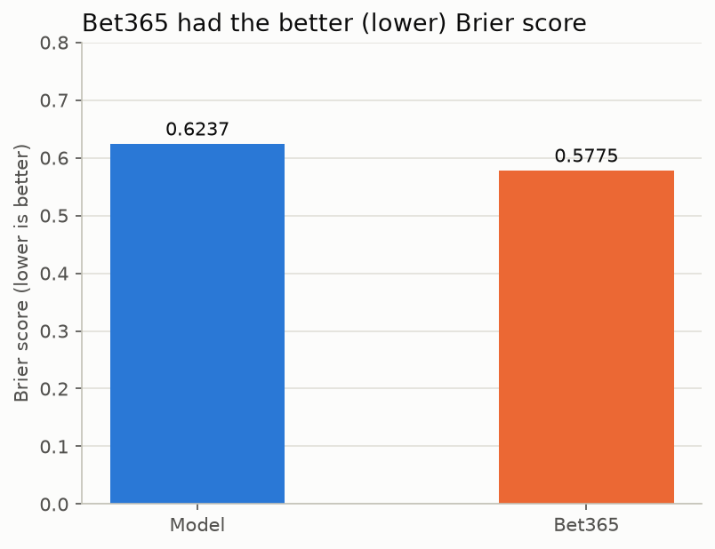
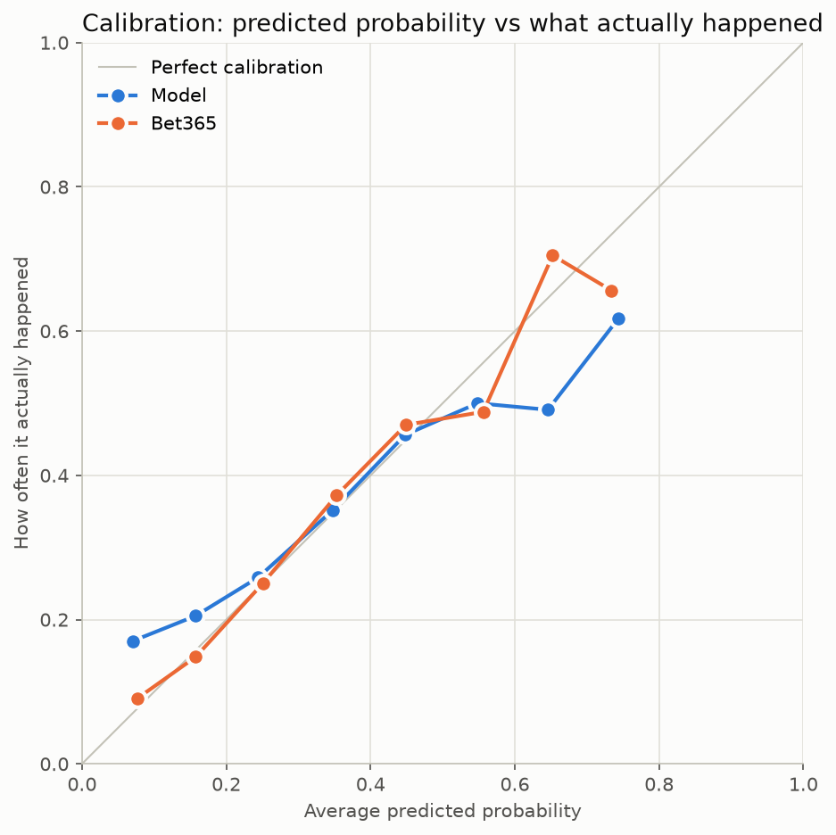

# Premier League Match Analysis and Prediction

[](https://github.com/Yurieb/premier-league-match-predictor/actions/workflows/tests.yml)

Can a simple statistical model built on past goals compete with a bookmaker at predicting football results?

This project analyses four Premier League seasons (2021/22 to 2024/25) using SQL and Python, then tests a Poisson model against Bet365's odds on a season the model never saw during training.

**Tools used:** Python, pandas, NumPy, SciPy, matplotlib, SQL (SQLite), Jupyter, pytest, GitHub Actions

## Key result

On 342 matches from the 2024/25 season, **Bet365 clearly beat the model. Updating the model's ratings during the season improved its predictions, but didn't catch Bet365.**

| Predictor | Brier score (lower is better) | Correct picks |
|---|---|---|
| Bet365 | **0.5775** | 183 (53.5%) |
| Poisson model, ratings updated during the season | 0.6109 | 176 (51.5%) |
| Poisson model, original fixed ratings | 0.6237 | 168 (49.1%) |
| Baseline (training seasons' result rates) | 0.6528 | 144 (42.1%) |

The gap between Bet365 and the original model is 4.5 standard errors from zero, so it's very unlikely to be chance alone. The gap between the original model and the baseline is 1.8 standard errors, which is suggestive but not conclusive. The [upgrade section](#upgrade-ratings-that-update-during-the-season) covers the updated model.

The full analysis is in [football_model.ipynb](football_model.ipynb).

## Questions

**Analysis, using SQL:**

1. How often do matches end in a home win, a draw or an away win?
2. How many goals are scored per match in each season?
3. Which teams have the best attacks and defences?
4. How often does the bookmaker's favourite win?

**Prediction:**

5. How well can a Poisson model predict results using only past goals?
6. How does it compare with Bet365's odds?

## SQL findings

These cover all 1,520 matches. The commented queries are in [sql/analysis.sql](sql/analysis.sql).

**Results**

| Result | Matches | Share |
|---|---|---|
| Home win | 677 | 44.5% |
| Away win | 493 | 32.4% |
| Draw | 350 | 23.0% |

**Goals per match**

| Season | Goals per match |
|---|---|
| 2021/22 | 2.82 |
| 2022/23 | 2.85 |
| 2023/24 | 3.28 |
| 2024/25 | 2.93 |

**Teams, ranked per match because not all teams played every season**

| Rank | Most goals scored | Fewest goals conceded |
|---|---|---|
| 1 | Man City, 2.38 | Man City, 0.90 |
| 2 | Liverpool, 2.24 | Arsenal, 1.01 |
| 3 | Arsenal, 2.03 | Liverpool, 1.02 |

**Favourites:** the team with the lowest odds won 57.1% of the 1,502 matches that had a clear favourite. The other 18 matches had identical home and away odds, so they were excluded.

## Method

**1. Data.** Match results and Bet365 odds come from [football-data.co.uk](https://www.football-data.co.uk/). Checks found no missing values, duplicate fixtures or results that contradicted the score, so no matches were removed. The notebook documents each cleaning decision.

**2. Train/test split.** The model learns from 2021/22 to 2023/24 (1,140 matches) and is tested on 2024/25 (380 matches). Splitting by time means the model only learns from the past, which avoids data leakage.

**3. Team strengths.** Each team gets four ratings relative to the league average: home attack, home defence, away attack and away defence.

**4. Poisson model.** Expected goals combine a team's attack, its opponent's defence and the league average:

```
Home expected goals = home attack x opponent's away defence x league average home goals
Away expected goals = away attack x opponent's home defence x league average away goals
```

The Poisson distribution turns expected goals into the chance of each exact score. Treating the two teams' goals as independent gives a grid of score probabilities, which adds up to home win, draw and away win probabilities.

**5. Bookmaker probabilities.** Implied probability is 1 ÷ decimal odds. These add up to more than 100% because of the bookmaker's margin, which averaged 5.52%. Each match's probabilities are scaled proportionally to add up to exactly 100%.

**6. Evaluation.** The Brier score measures how close the probabilities were to what happened, and it penalises confident mistakes most heavily. Correct picks count how often the most likely result was the real one.

Ipswich had no training data, so its 38 matches were skipped for all predictors, leaving 342 of the 380 test matches.

## Results

These results and charts are for the original model, with ratings fixed before the test season.



The model scored between the baseline and the bookmaker. Team ratings based only on past goals seem to add useful information, but they don't match the bookmaker's accuracy.



Both predictors were well calibrated between about 20% and 50%. The model was **overconfident at the extremes**:

| Model's prediction | Times it happened | How often it happened |
|---|---|---|
| 60-70% | 27 of 55 | 49.1% |
| 70-80% | 21 of 34 | 61.8% |
| Under 10% | 8 of 47 | 17.0% |

Bet365 stayed within about 8 percentage points of perfect calibration in every plotted band. The chart only plots bands with at least 20 predictions, because smaller bands are mostly noise. The notebook lists every band, including those left out.

The largest disagreements between the two involved teams such as Tottenham and Nott'm Forest. A likely explanation is that the model's ratings stay fixed for the whole test season, while the bookmaker can react to form, injuries and transfers. The upgrade below tests part of this explanation.

The model also expected too many home wins across the 342 matches (47.0%, against 42.1% in reality). That fits with 2024/25 having the lowest home win rate of the four seasons (40.8% across all 380 matches).

## Upgrade: ratings that update during the season

The original model's ratings stay fixed for the whole test season. The updated model recalculates them before each matchday, using every result from earlier dates. A prediction never uses results from its own date or later, which the [tests](tests/test_model.py) check. Both models are scored on the same 342 matches.

| Measure | Original model | Updated model | Bet365 |
|---|---|---|---|
| Brier score (lower is better) | 0.6237 | **0.6109** | 0.5775 |
| Correct picks | 168 (49.1%) | **176 (51.5%)** | 183 (53.5%) |
| Brier gap to Bet365 | 0.0462 | **0.0334** | n/a |

**What this shows:**

- **It's a real improvement in this season.** Compared match by match, the Brier score improvement is 4.1 standard errors from zero, so it's very unlikely to be chance alone.
- **Frozen ratings explain only part of the gap.** Updating closed about a quarter of the gap to Bet365. The updated model is still 3.9 standard errors behind.
- **It now beats the baseline more clearly.** The gap to the baseline is 2.7 standard errors, up from 1.8 for the original model.
- **Overconfidence reduced, but didn't disappear.** The bands below contain few predictions, so these numbers are less reliable.

| Model's prediction | Original model: how often it happened | Updated model: how often it happened |
|---|---|---|
| 60-70% | 49.1% (of 55 predictions) | 54.2% (of 59 predictions) |
| 70-80% | 61.8% (of 34 predictions) | 64.3% (of 28 predictions) |
| Under 10% | 17.0% (of 47 predictions) | 11.1% (of 36 predictions) |

This upgrade has no settings to tune, so 2024/25 wasn't used to choose anything. All matches still count equally.

## Limitations

- **Slow-changing ratings:** in the original model, team strengths don't change during the test season. In the updated model they do, but a 2021 match still counts as much as a 2025 match, so ratings react slowly to change.
- **Goals only:** the model doesn't use injuries, transfers, shot quality or other information a bookmaker can use.
- **Independent goals:** it assumes one team's goals don't affect the other's, although a losing team may change how it plays. Basic Poisson models like this are also known to tend to underestimate low-scoring draws.
- **Opponent strength:** ratings don't adjust for the quality of the teams faced.
- **Small samples:** some teams have only 38 training matches, which makes their ratings less reliable.
- **One test season:** results may differ in other seasons, and the standard errors treat matches as independent.
- **Promoted teams:** teams with no training data can't be predicted, so the comparison leaves out Ipswich's matches.
- **Odds used:** these are Bet365's pre-closing odds. Closing odds, set nearer kick-off, are usually considered more accurate, so they may be a harder benchmark.
- **Margin removal:** the proportional method assumes the margin is spread evenly across the three outcomes.

## Possible next steps

- Give recent matches more weight, choosing the weighting without using the final test season.
- Add the Dixon-Coles adjustment for low-scoring results.
- Test on more seasons.
- Simulate betting against the odds to see whether the model finds any value.

## How to run it

Developed with Python 3.14. On Windows PowerShell:

```powershell
git clone https://github.com/Yurieb/premier-league-match-predictor.git
cd premier-league-match-predictor
python -m venv venv
.\venv\Scripts\Activate.ps1
pip install pandas numpy scipy matplotlib jupyter pytest
jupyter notebook football_model.ipynb
```

Then choose **Run All Cells**. The notebook needs an internet connection, because it downloads the data from football-data.co.uk each time it runs.

To run the tests, which don't need an internet connection:

```powershell
python -m pytest
```

## Tests

The tests check the model's calculations and the SQL queries against small examples with answers worked out by hand. GitHub Actions runs them each time code is pushed, and the badge at the top of this page shows the latest result.

## Project files

| File | Contents |
|---|---|
| [football_model.ipynb](football_model.ipynb) | Full project: data, cleaning, charts, model, evaluation and results |
| [model.py](model.py) | The original and updated model, bookmaker probability and scoring functions |
| [sql/analysis.sql](sql/analysis.sql) | The SQL analysis queries, with comments |
| [tests/](tests/) | Automatic tests for the model functions and SQL queries |
| [.github/workflows/tests.yml](.github/workflows/tests.yml) | Runs the tests on GitHub |
| [images/](images/) | Saved final charts used in this README |

## License

[MIT](LICENSE)
